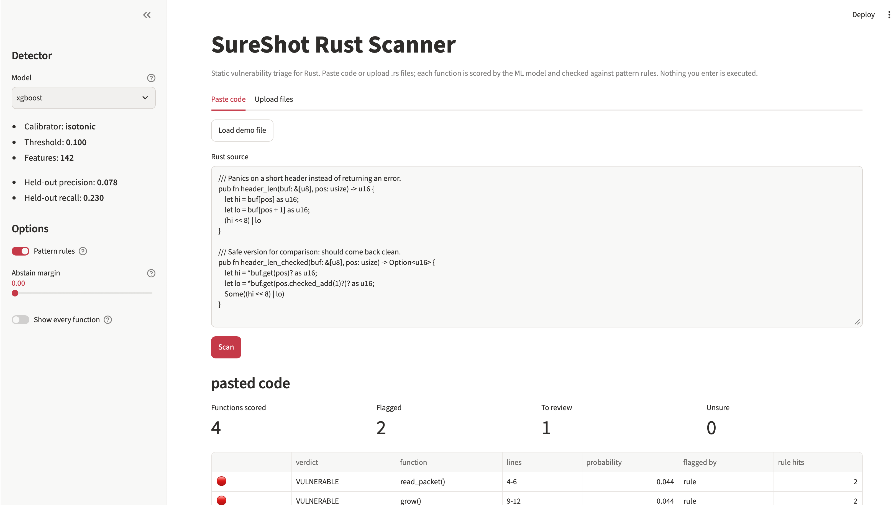

<div align="center">

# NAME: TAMUSA Software Engineering I Term Project


[Noah Sizemore](https://github.com/NoahSizemore) &nbsp;•&nbsp; [David Hinojosa]() &nbsp;•&nbsp; [William Hale](https://github.com/williamhale210-ai)

</div>

## 📝 Project Scope

Assigned to us by the TAMUSA Software Engineering I professor:

- As a team, develop a software application through the entire development life cycle. This means performing requirements analysis, designing, implementing a functioning prototype, testing, and documenting the system.
- Develop a tool that helps programmers analyze source code and identify security vulnerabilities.
- Target programming language: **Rust**


## 📖 About The Project

This project is a Python-based program that does the following:

* Takes Rust code as input (adjusted to also accept Rust files).
* A pretrained XGBoost model then assesses whether vulnerabilities are present in the code.
* Alongside its final decision, the model outputs how certain it is in its answer.

There are multiple ways to use this program. You can:

* Train your own XGBoost model.
    * Adjust rules, change parameters, input additional testing code, etc.
* Run this all in the terminal.
    * The code was built originally for the terminal, so all functionality remains.
* Run this using Streamlit.
    * A local GUI client that runs in your browser and provides an easy-to-use way to test code.
    * You cannot retrain the model through the GUI.

The repo also includes a slideshow presentation covering topics from the SWE I class.

Please review the **How to use the model** section in full. How you use our project may differ depending on your intent.

<div align="center">
  
  <br>
  What the GUI client looks like after scanning some vulnerable code**
</div>


## How to use the model

#### 1. One-time setup

Python 3.12 or 3.14 is recommended (the pinned packages have prebuilt wheels for both).

**Windows**:
```bash
cd sureshot
python -m venv .venv
.venv\Scripts\activate            # PowerShell / cmd
# source .venv/Scripts/activate   # Git Bash
pip install -r requirements.txt
```

`run_model.sh` is a bash script; on Windows, run it from Git Bash.

**macOS / Linux**:
```bash
cd sureshot
python3 -m venv .venv
source .venv/bin/activate
pip install -r requirements.txt
```

> **macOS only:** XGBoost needs the OpenMP runtime, which pip cannot install. Run `brew install libomp` if you have Homebrew. Without it, `run_model.sh` falls back automatically to the copy that scikit-learn ships, so the script still works. To import `xgboost` in your own shell without Homebrew, run this after activating:
> ```bash
> export DYLD_FALLBACK_LIBRARY_PATH="$(python -c 'import os, sklearn; print(os.path.join(os.path.dirname(sklearn.__file__), ".dylibs"))')"
> ```

#### 2. Run everything

Tests, both models, the size ablation, the comparison and a demo scan, in one command:
```bash
cd sureshot
bash run_model.sh
```

`bash run_model.sh --help` lists the options. The calibrator is chosen with `--select-on calib` by default (leak-free); pass `--select-on test` to reproduce reports made before that default changed.

#### 3. Or run the steps yourself

With the venv activated, from `sureshot/`:

```bash
# train + evaluate + save, in one run
python scripts/train_XGBoost.py \
    --data data/processed/rustsec_v0.1.parquet \
    --source-type rustsec --seed 42 \
    --report reports/mine.json \
    --save artifacts/xgboost

# same for the baseline
python scripts/train_scikit-learn.py \
    --data data/processed/rustsec_v0.1.parquet \
    --source-type rustsec --seed 42 \
    --report reports/reference.json --save artifacts/reference

# side-by-side the two reports
python -c "from sureshot.pipeline import compare; compare('reports/reference.json','reports/mine.json')"

# run the tests
python -m pytest -q
```

On Windows PowerShell, replace the trailing `\` line breaks with a backtick (`` ` ``), or put each command on one line.

#### 4. Scan Rust code

```bash
python scripts/scan.py --model artifacts/xgboost path/to/file_or_folder
```

Each function is checked two ways: by the ML model, and by pattern rules (`src/sureshot/rules.py`) that point at specific risky constructs such as `transmute`, `from_raw_parts` or raw pointer copies. A function is flagged **VULNERABLE** if the model flags it or a high-severity rule fires; medium-severity hits are listed as **review**. Useful options:

| Option | Effect |
|---|---|
| `--all` | list every function, not just flagged ones |
| `--json` | machine-readable output, including each rule hit |
| `--no-rules` | model-only output |
| `--abstain-margin 0.05` | report UNSURE when the model is close to its threshold |

Exit code `0` means nothing flagged, `1` means something was flagged, `2` means a usage error.

#### 5. Scan from a GUI

A browser interface for pasting or uploading Rust code and seeing the results. It only evaluates code with an already-saved model; it never trains and never runs the code you give it.

```bash
cd sureshot
pip install -r requirements-gui.txt   # once; adds Streamlit, leaves the core pins unchanged
streamlit run app.py
```

It opens at `http://localhost:8501`. In the sidebar, choose a model from `artifacts/`, turn the pattern rules on or off, and set an abstain margin. Press **Load demo file** to try it, then **Scan**. Results can be downloaded as JSON.

## AI Usage Statement

We thoughtfully disclose our use of LLMs. LLMs were used for (i) assisting in improving, debugging, and cleaning author-written code, with all changes verified before implementation; (ii) improving comments in the code to ensure proper readability; (iii) ensuring functionality across multiple machines (e.g., macOS, Linux, Windows); (iv) adjusting grammar and spelling wherever documentation is present; and (v) assisting in making the Streamlit functionality work properly across machines. LLMs were not used for creating the model, training the model, writing the rules for the model, defining the scope of the project, or other less-major tasks. No LLM output was implemented without verification by the authors.